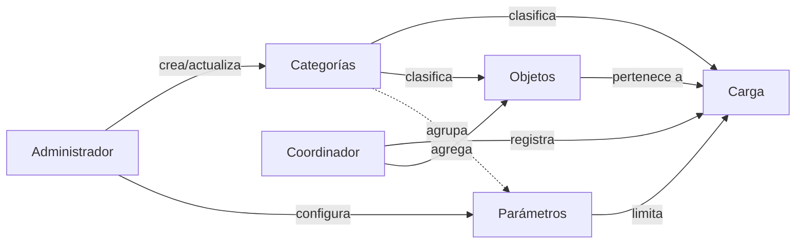

# 01 · Modelo de negocio

> Proyecto académico de la asignatura de Pruebas de Software.
> La empresa, los datos y los valores numéricos descritos en este documento son **ficticios**.

## 1. Descripción del negocio

**Griwolf Carga Pesada S.A.S.** (empresa ficticia) presta servicios de transporte terrestre de carga
pesada entre ciudades de Colombia: maquinaria industrial, equipos eléctricos, materiales de construcción,
repuestos y mercancía general.

Cada vez que un cliente contrata un traslado, la empresa registra un **servicio de transporte (Carga)**
y detalla las **mercancías (Objetos)** que lo componen. Para clasificar la información utiliza
**catálogos (Categorías)** y para fijar límites operativos utiliza **configuraciones (Parámetros)**.

## 2. Problema que resuelve el sistema

Antes del sistema, la información se llevaba en hojas de cálculo con los siguientes problemas:

| Problema | Consecuencia | Solución en el sistema |
|---|---|---|
| Códigos de servicio repetidos | No se podía identificar una carga de forma inequívoca | Código de carga único (RN-01) |
| Clasificaciones escritas a mano ("tracto", "tractocamión", "TC") | Reportes inconsistentes | Catálogo genérico tipado `Categorias` (RN-07) |
| Un tipo de vehículo escrito en la columna "tipo de carga" | Datos sin sentido | Validación del tipo de categoría según su uso (RN-07, RN-08) |
| Pesos negativos o en cero, cantidades en cero | Planeación errónea | Validaciones físicas (RN-04, RN-05) |
| Mercancías declaradas que pesan más que la carga | Riesgo operativo | Coherencia de pesos (RN-18) |
| Límites operativos "quemados" en el criterio de cada coordinador | Decisiones arbitrarias | Parámetros configurables con tipo de dato (RN-10, RN-17) |
| Borrado de registros que otros datos usaban | Pérdida de historial | Políticas de eliminación controlada (RN-12, RN-13, RN-14) |

## 3. Actores

| Actor | Tipo | Responsabilidad |
|---|---|---|
| Coordinador de despacho | Humano | Registra, consulta, actualiza y elimina cargas y sus objetos. Cambia el estado de la carga. |
| Administrador de configuración | Humano | Mantiene los catálogos (categorías) y los parámetros del sistema. |
| Supervisor de operaciones | Humano | Consulta cargas, objetos y estados. |
| Analista de pruebas (QA) | Humano | Ejecuta pruebas funcionales, negativas y de integración sobre la API. |
| Interfaz web | Sistema | Cliente de la API REST que usan los actores humanos. |
| Postman / Newman / xUnit | Sistema | Clientes de prueba de la API. |

> El sistema no implementa autenticación (exclusión acordada). Los actores se describen para entender
> el negocio y diseñar los casos de prueba, no para controlar permisos.

## 4. Procesos principales

1. **Configurar catálogos**: el administrador crea las categorías de cada tipo (vehículos, tipos de carga,
   tipos de entrega, estados, unidades de medida y tipos de objeto).
2. **Configurar parámetros**: el administrador ajusta los límites configurables (peso y volumen máximos,
   capacidad por tipo de vehículo, unidad predeterminada).
3. **Registrar una carga**: el coordinador registra el código, la descripción, el origen, el destino, el peso y el
   volumen declarados y sus clasificaciones. Si no indica el estado, la carga se crea como `PENDIENTE`.
4. **Registrar los objetos de la carga**: el coordinador agrega cada mercancía con su cantidad, su peso unitario y su
   volumen unitario. El sistema impide que el peso de los objetos supere el peso declarado de la carga.
5. **Actualizar el estado de la carga**: `PENDIENTE` → `EN_TRANSITO` → `ENTREGADA` (el sistema no impone
   la secuencia; ver supuestos).
6. **Depurar información**: eliminar objetos, eliminar cargas sin objetos y desactivar las categorías o los parámetros
   que ya no se usan.

## 5. Entidades

| Entidad | Qué representa | Ejemplo |
|---|---|---|
| **Carga** | Un servicio de transporte entre un origen y un destino | `CP-2026-0001`: maquinaria industrial Bogotá → Medellín, 28 000 kg |
| **Objeto** | Una mercancía física que forma parte de una carga | 1 excavadora de 21 000 kg; 2 motores de 1 500 kg |
| **Categoría** | Un valor de catálogo para clasificar | `VEHICULO / TRACTOCAMION`, `ESTADO_CARGA / EN_TRANSITO` |
| **Parámetro** | Una configuración con tipo de dato y valor | `PESO_MAXIMO_CARGA_KG = 40000` (DECIMAL, kg) |

**Una categoría no es un objeto.** "Tractocamión" es un dato de clasificación del sistema; una
"Excavadora CAT 320" es un elemento físico que se transporta.

## 6. Catálogos (tipos de categoría)

La tabla `Categorias` es un catálogo **genérico tipado**. Los tipos permitidos están centralizados en el código
(`Services/Reglas/TiposCategoria.cs`):

| TipoCategoria | Uso | Quién lo referencia |
|---|---|---|
| `VEHICULO` | Tipo de vehículo asignado al servicio | `Carga.TipoVehiculoId` (opcional) |
| `TIPO_CARGA` | Naturaleza de la carga | `Carga.TipoCargaId` (obligatorio) |
| `TIPO_ENTREGA` | Modalidad de entrega | `Carga.TipoEntregaId` (obligatorio) |
| `ESTADO_CARGA` | Estado operativo del servicio | `Carga.EstadoId` (obligatorio, por defecto `PENDIENTE`) |
| `UNIDAD_MEDIDA` | Unidades de medida de referencia | Informativo; se pueden asociar parámetros |
| `TIPO_OBJETO` | Clasificación de mercancías | `Objeto.CategoriaId` (opcional) |

Los registros iniciales (por ejemplo `TRACTOCAMION`, `REFRIGERADA` y `EN_TRANSITO`) son **datos de ejemplo**: el sistema
los carga la primera vez que se crea la base de datos y pueden modificarse.

## 7. Parámetros

| Clase | Definición | Ejemplos (valores de ejemplo) |
|---|---|---|
| **General del sistema** | `CategoriaId = null`. Aplica a todo el sistema. | `PESO_MAXIMO_CARGA_KG = 40000`, `VOLUMEN_MAXIMO_CARGA_M3 = 90`, `UNIDAD_PESO_PREDETERMINADA = KILOGRAMO` |
| **Asociado a una categoría** | `CategoriaId` apunta a una categoría concreta. Aplica solo cuando se usa esa categoría. | `CAPACIDAD_KG_TRACTOCAMION = 34000` → `VEHICULO/TRACTOCAMION`; `TEMPERATURA_MAXIMA_C = 4` → `TIPO_CARGA/REFRIGERADA` |

Parámetros con efecto en las reglas (los demás son informativos):

- `PESO_MAXIMO_CARGA_KG`: peso total máximo de cualquier carga.
- `VOLUMEN_MAXIMO_CARGA_M3`: volumen total máximo de cualquier carga.
- `CAPACIDAD_KG_*` asociado a una categoría `VEHICULO`: peso máximo de una carga asignada a ese tipo de vehículo.

> **Importante:** los valores de peso y volumen **no son límites legales** de transporte en Colombia ni en otro país.
> Son reglas académicas configurables que permiten diseñar pruebas de valores límite.

## 8. Reglas de negocio (resumen)

El detalle, con criterios de aceptación, está en [02-requisitos-y-reglas.md](02-requisitos-y-reglas.md).

| ID | Regla |
|---|---|
| RN-01 | El código de carga es único. |
| RN-02 | Los campos obligatorios no pueden ser vacíos ni contener solo espacios. |
| RN-03 | El origen y el destino tienen entre 3 y 100 caracteres y no pueden ser iguales. |
| RN-04 | El peso y el volumen no pueden ser negativos (el peso debe ser mayor que 0). |
| RN-05 | La cantidad de un objeto debe ser mayor que 0. |
| RN-06 | Los identificadores relacionados deben existir. |
| RN-07 | El tipo de categoría debe corresponder al uso (no se acepta un `VEHICULO` como `TIPO_CARGA`). |
| RN-08 | Una carga no puede referenciar una categoría inexistente o inactiva. |
| RN-09 | Un objeto no puede pertenecer a una carga inexistente. |
| RN-10 | El valor de un parámetro debe respetar su tipo de dato declarado. |
| RN-11 | El código de una categoría es único dentro de su tipo. |
| RN-12 | La eliminación respeta las dependencias. |
| RN-13 | No se elimina una carga con objetos asociados. |
| RN-14 | Las categorías en uso no se eliminan: se desactivan. |
| RN-15 | Los errores producen códigos HTTP coherentes. |
| RN-16 | No se exponen excepciones internas ni datos sensibles. |
| RN-17 | El peso y el volumen de la carga respetan los parámetros de límite configurados. |
| RN-18 | La suma del peso de los objetos no supera el peso total declarado de la carga. |
| RN-19 | Los parámetros obligatorios no se eliminan ni se desactivan, y no cambian su código ni su tipo de dato. |

## 9. Supuestos

- S-01: Las ubicaciones (origen y destino) se registran como texto libre (ciudad o municipio). No se valida contra un
  catálogo geográfico.
- S-02: El peso se expresa siempre en kilogramos y el volumen en metros cúbicos. `UNIDAD_MEDIDA` es informativo.
- S-03: El sistema no impone una secuencia de estados (por ejemplo, permite volver de `EN_TRANSITO` a `PENDIENTE`).
  Se deja como mejora futura.
- S-04: Un cambio en un parámetro de límite aplica a las operaciones futuras; no invalida retroactivamente las cargas
  existentes.
- S-05: Una sola instancia y un solo usuario concurrente (entorno académico).

## 10. Exclusiones

GPS y rastreo, facturación, pagos, nómina, contratación de conductores, gestión de clientes, autenticación y
autorización, integraciones externas, despliegue en la nube y límites legales de peso y dimensiones.
