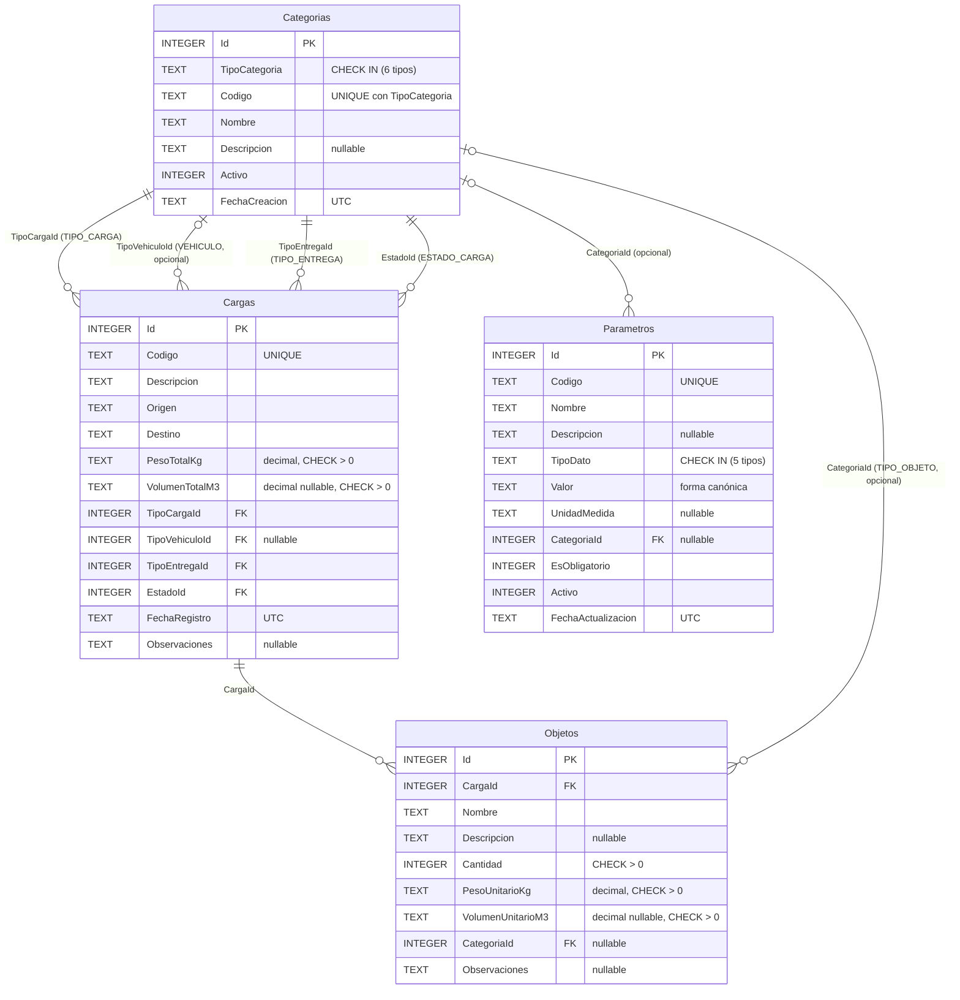

# 03 · Modelo de datos

- Motor: **SQLite**, con acceso mediante **Entity Framework Core 10.0.13**.
- Esquema reproducible con la migración `Data/Migrations/*_InicialTransporte.cs`, que se aplica al iniciar (`Database.Migrate()`).
- Base de datos de la aplicación: `src/TransporteCargaPesada.Web/App_Data/transporte.db`
  (`ConnectionStrings:DefaultConnection` en `appsettings.json`; si la ruta es relativa, se resuelve respecto de la carpeta del proyecto).
- Base de datos de las pruebas xUnit: un archivo temporal por clase de prueba en `%TEMP%\TransporteCargaPesada.Tests\` (ver CP-INT-006).
- Datos de ejemplo: `Data/DbSeeder.cs` los inserta **solo si la tabla `Categorias` está vacía**. Nunca borra datos.

## 1. Diagrama entidad-relación

> SQLite no tiene un tipo `decimal` nativo. EF Core guarda los `decimal` como TEXT y los convierte al leer;
> por eso las restricciones CHECK usan `CAST(... AS REAL)`.

## 2. Entidades y atributos

### 2.1. Categorias

Catálogo genérico. `TipoCategoria` determina para qué sirve cada registro.

| Atributo | Tipo .NET | Nulo | Restricciones | Descripción |
|---|---|---|---|---|
| Id | int | No | PK, autoincremental | Identificador. |
| TipoCategoria | string(30) | No | CHECK en la lista de tipos | `VEHICULO`, `TIPO_CARGA`, `TIPO_ENTREGA`, `ESTADO_CARGA`, `UNIDAD_MEDIDA`, `TIPO_OBJETO`. |
| Codigo | string(50) | No | Único con `TipoCategoria`; `^[A-Z][A-Z0-9_]{1,49}$` | Se guarda en mayúsculas. |
| Nombre | string(100) | No | 2 a 100 caracteres | Nombre visible. |
| Descripcion | string(300) | Sí | | |
| Activo | bool | No | Por defecto true | Las categorías inactivas no se asignan a registros nuevos. |
| FechaCreacion | DateTime (UTC) | No | | La asigna el servidor. |

### 2.2. Cargas

| Atributo | Tipo .NET | Nulo | Restricciones | Descripción |
|---|---|---|---|---|
| Id | int | No | PK | |
| Codigo | string(20) | No | Único; `^[A-Z0-9][A-Z0-9-]{2,19}$` | Por ejemplo `CP-2026-0001`; se guarda en mayúsculas. |
| Descripcion | string(300) | No | 3 a 300 caracteres | |
| Origen / Destino | string(100) | No | 3 a 100 caracteres; distintos entre sí | |
| PesoTotalKg | decimal | No | > 0; ≤ `PESO_MAXIMO_CARGA_KG`; ≤ `CAPACIDAD_KG_*` del vehículo | Peso declarado. |
| VolumenTotalM3 | decimal | Sí | > 0; ≤ `VOLUMEN_MAXIMO_CARGA_M3` | |
| TipoCargaId | int | No | FK → Categorias (TIPO_CARGA) | |
| TipoVehiculoId | int | Sí | FK → Categorias (VEHICULO) | El vehículo puede definirse después. |
| TipoEntregaId | int | No | FK → Categorias (TIPO_ENTREGA) | |
| EstadoId | int | No | FK → Categorias (ESTADO_CARGA) | Por defecto `PENDIENTE`. |
| FechaRegistro | DateTime (UTC) | No | | La asigna el servidor y no cambia al actualizar. |
| Observaciones | string(500) | Sí | | |

### 2.3. Objetos

| Atributo | Tipo .NET | Nulo | Restricciones | Descripción |
|---|---|---|---|---|
| Id | int | No | PK | |
| CargaId | int | No | FK → Cargas | Carga a la que pertenece. |
| Nombre | string(100) | No | 2 a 100 caracteres | |
| Descripcion | string(300) | Sí | | |
| Cantidad | int | No | CHECK > 0; ≤ 100 000 (límite técnico) | |
| PesoUnitarioKg | decimal | No | CHECK > 0 | |
| VolumenUnitarioM3 | decimal | Sí | CHECK > 0 | |
| CategoriaId | int | Sí | FK → Categorias (TIPO_OBJETO) | Clasificación opcional. |
| Observaciones | string(500) | Sí | | |

### 2.4. Parametros

| Atributo | Tipo .NET | Nulo | Restricciones | Descripción |
|---|---|---|---|---|
| Id | int | No | PK | |
| Codigo | string(50) | No | Único global; `^[A-Z][A-Z0-9_]{1,49}$` | |
| Nombre | string(100) | No | | |
| Descripcion | string(300) | Sí | | |
| TipoDato | string(20) | No | CHECK en `ENTERO`, `DECIMAL`, `TEXTO`, `BOOLEANO`, `FECHA` | |
| Valor | string(200) | No | Compatible con `TipoDato` | Se guarda en forma canónica e invariante (`40000.5`, `true`, `2026-12-31`). |
| UnidadMedida | string(20) | Sí | | Informativa (`kg`, `m3`, `°C`). |
| CategoriaId | int | Sí | FK → Categorias | **null = parámetro general**; con valor = parámetro de esa categoría. |
| EsObligatorio | bool | No | | Lo usan las reglas del sistema: no se elimina ni se desactiva. |
| Activo | bool | No | | Los parámetros de límite inactivos no se aplican. |
| FechaActualizacion | DateTime (UTC) | No | | Se actualiza en cada `POST`/`PUT`. |

**Parámetros generales y por categoría:**

| Ámbito | Condición | Parámetros de ejemplo |
|---|---|---|
| General del sistema | `CategoriaId IS NULL` | `PESO_MAXIMO_CARGA_KG`, `VOLUMEN_MAXIMO_CARGA_M3`, `UNIDAD_PESO_PREDETERMINADA`, `MAX_OBJETOS_SUGERIDOS` |
| De categoría | `CategoriaId IS NOT NULL` | `CAPACIDAD_KG_TRACTOCAMION` y `CAPACIDAD_KG_CAMION_RIGIDO` (VEHICULO), `TEMPERATURA_MAXIMA_C` (REFRIGERADA), `REQUIERE_ESCOLTA` (SOBREDIMENSIONADA) |

Reglas adicionales sobre los códigos de límite (`ParametrosSistema.cs`): `PESO_MAXIMO_CARGA_KG` y `VOLUMEN_MAXIMO_CARGA_M3`
deben ser numéricos, mayores que 0 y **sin** categoría. Los `CAPACIDAD_KG_*` deben ser numéricos, mayores que 0 y asociarse a una
categoría `VEHICULO`.

## 3. Relaciones y su justificación

| Relación | Cardinalidad | FK | Al eliminar | Justificación |
|---|---|---|---|---|
| Carga → Categoría (tipo de carga) | N:1 obligatoria | `FK_Cargas_Categorias_TipoCargaId` | Restrict | Toda carga tiene una naturaleza (general, refrigerada…). |
| Carga → Categoría (vehículo) | N:0..1 | `FK_Cargas_Categorias_TipoVehiculoId` | Restrict | El vehículo puede asignarse después del registro. |
| Carga → Categoría (entrega) | N:1 obligatoria | `FK_Cargas_Categorias_TipoEntregaId` | Restrict | Modalidad contratada. |
| Carga → Categoría (estado) | N:1 obligatoria | `FK_Cargas_Categorias_EstadoId` | Restrict | Estado operativo del servicio. |
| Objeto → Carga | N:1 obligatoria | `FK_Objetos_Cargas_CargaId` | **Restrict** (no Cascade) | Un objeto existe solo dentro de una carga. Restrict evita borrar mercancías accidentalmente (RN-13). |
| Objeto → Categoría | N:0..1 | `FK_Objetos_Categorias_CategoriaId` | Restrict | Clasificación opcional de la mercancía. |
| Parámetro → Categoría | N:0..1 | `FK_Parametros_Categorias_CategoriaId` | Restrict | Configuración que aplica solo a una categoría concreta (por ejemplo, la capacidad de un vehículo). |

**Relaciones que no se crearon:** Parámetro ↔ Carga y Parámetro ↔ Objeto. Las reglas consultan los parámetros por código
cuando se necesitan, así que una FK no aportaría integridad y acoplaría la configuración con los datos operativos.

**Coherencia de tipo:** una FK solo garantiza que la categoría exista. Que sea del tipo correcto (RN-07) se valida en
`ValidadorReferencias`, porque SQLite no permite claves foráneas condicionadas a otra columna.

## 4. Índices

| Índice | Tabla | Columnas | Único | Propósito |
|---|---|---|---|---|
| IX_Cargas_Codigo | Cargas | Codigo | Sí | RN-01 |
| IX_Categorias_TipoCategoria_Codigo | Categorias | TipoCategoria, Codigo | Sí | RN-11 y filtro por tipo |
| IX_Parametros_Codigo | Parametros | Codigo | Sí | Unicidad y búsqueda por código |
| IX_Cargas_TipoCargaId, IX_Cargas_TipoVehiculoId, IX_Cargas_TipoEntregaId, IX_Cargas_EstadoId | Cargas | FK | No | Conteo de usos de una categoría |
| IX_Objetos_CargaId | Objetos | CargaId | No | `GET /api/cargas/{id}/objetos` |
| IX_Objetos_CategoriaId | Objetos | CategoriaId | No | Conteo de usos |
| IX_Parametros_CategoriaId | Parametros | CategoriaId | No | Filtro `?categoriaId=` |

## 5. Restricciones CHECK

| Restricción | Expresión |
|---|---|
| CK_Categorias_TipoCategoria | `TipoCategoria IN ('VEHICULO','TIPO_CARGA','TIPO_ENTREGA','ESTADO_CARGA','UNIDAD_MEDIDA','TIPO_OBJETO')` |
| CK_Parametros_TipoDato | `TipoDato IN ('ENTERO','DECIMAL','TEXTO','BOOLEANO','FECHA')` |
| CK_Cargas_PesoTotalKg | `CAST(PesoTotalKg AS REAL) > 0` |
| CK_Cargas_VolumenTotalM3 | `VolumenTotalM3 IS NULL OR CAST(VolumenTotalM3 AS REAL) > 0` |
| CK_Objetos_Cantidad | `Cantidad > 0` |
| CK_Objetos_PesoUnitarioKg | `CAST(PesoUnitarioKg AS REAL) > 0` |
| CK_Objetos_VolumenUnitarioM3 | `VolumenUnitarioM3 IS NULL OR CAST(VolumenUnitarioM3 AS REAL) > 0` |

Las restricciones son una **segunda línea de defensa**. La primera son las validaciones de los servicios, que devuelven
mensajes claros (400/409). CP-INT-002 y CP-INT-003 verifican que la base de datos rechaza los datos inválidos aunque se omita la API.

## 6. Datos de ejemplo (sembrados la primera vez)

Son **datos de ejemplo** y pueden modificarse o desactivarse desde la interfaz o la API.

| Tipo | Códigos |
|---|---|
| VEHICULO | TRACTOCAMION, CAMION_RIGIDO, CAMA_BAJA |
| TIPO_CARGA | GENERAL, REFRIGERADA, SOBREDIMENSIONADA |
| TIPO_ENTREGA | DIRECTA, PROGRAMADA |
| ESTADO_CARGA | PENDIENTE, EN_TRANSITO, ENTREGADA |
| UNIDAD_MEDIDA | KILOGRAMO, TONELADA, METRO_CUBICO |
| TIPO_OBJETO | MAQUINARIA, REPUESTOS, EQUIPO_ELECTRICO, MATERIAL_CONSTRUCCION |

Parámetros: `PESO_MAXIMO_CARGA_KG = 40000` (obligatorio), `VOLUMEN_MAXIMO_CARGA_M3 = 90` (obligatorio),
`UNIDAD_PESO_PREDETERMINADA = KILOGRAMO` (obligatorio), `CAPACIDAD_KG_TRACTOCAMION = 34000`, `CAPACIDAD_KG_CAMION_RIGIDO = 17000`,
`TEMPERATURA_MAXIMA_C = 4`, `REQUIERE_ESCOLTA = true` y `MAX_OBJETOS_SUGERIDOS = 50`.
Todos son valores académicos, no límites legales.

Cargas: `CP-2026-0001` (Bogotá → Medellín, 28 000 kg, 2 objetos) y `CP-2026-0002` (Barranquilla → Bucaramanga, 15 000 kg, 1 objeto).

## 7. Reinicio de la base de datos

Detenga la aplicación y elimine `App_Data/transporte.db*`. En el siguiente arranque se crea el esquema y se siembran de nuevo
los datos de ejemplo.
